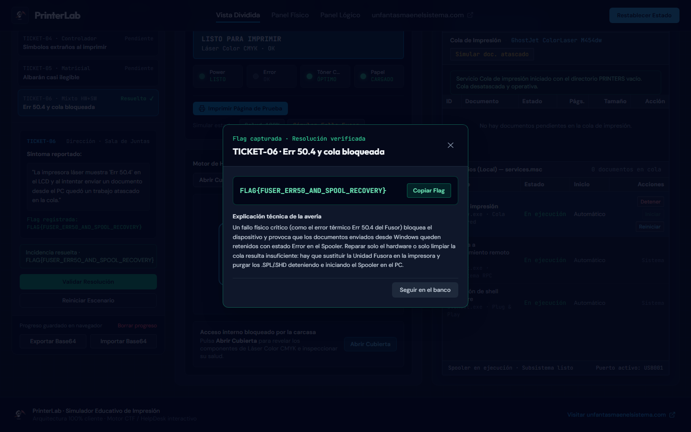
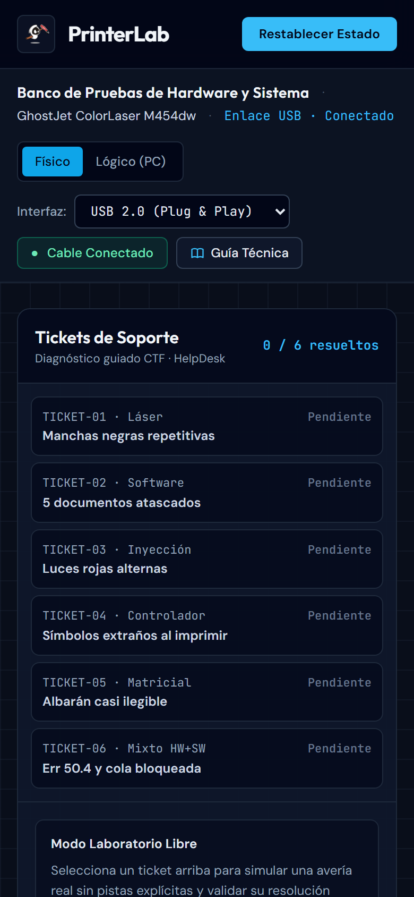

<p align="center">
  <a href="https://www.unfantasmaenelsistema.com/" target="_blank" rel="noopener noreferrer">
    
  </a>
</p>

<h1 align="center">PrinterLab</h1>

<p align="center">
  <strong>Simulador interactivo de diagnóstico y resolución de averías de impresión (Hardware + Windows Spooler + CTF HelpDesk)</strong>
</p>

<p align="center">
  
  
  <a href="https://unfantasmaenelsistema.github.io/PrinterLab/"></a>
  
</p>

<p align="center">
  Proyecto educativo de <a href="https://www.unfantasmaenelsistema.com/" target="_blank" rel="noopener noreferrer">unfantasmaenelsistema.com</a>
</p>

<p align="center">
  <strong><a href="https://unfantasmaenelsistema.github.io/PrinterLab/">▶ Abrir el simulador</a></strong>
</p>

---

## Descripción general

**PrinterLab** es un laboratorio virtual monolítico diseñado para ejecutarse **100 % en el navegador del cliente** (sin backend ni base de datos), orientado a estudiantes de informática, técnicos de soporte N1/N2 y prácticas de HelpDesk.

Combina en un mismo entorno interactivo el **hardware físico de tres tecnologías de impresión** (Láser CMYK, Inyección de Tinta y Matricial de agujas) con una **consola lógica de administración estilo Microsoft Windows (MMC 3.0)** y un **motor de retos CTF / HelpDesk** con validación automática y explicaciones técnicas reales.

---

## Capturas reales de la aplicación

> Capturas de la versión 2 tomadas sobre la compilación de producción.

### 1. Vista dividida completa (HelpDesk + Panel Físico + Consola Windows MMC)


### 2. Motor de Hardware abierto, tooltips educativos y simulación de defectos en papel


### 3. Diagnóstico combinado Hardware + Spooler (`Err 50.4` y documento bloqueado en cola)


### 4. Validación CTF ("Flag capturada") y explicación técnica de la causa raíz


### 5. Versión móvil


---

## Funcionalidades principales

### 1. Panel Físico (Hardware de Impresión)
- **Tres tecnologías simuladas**:
  - **Láser Color CMYK (`GhostJet ColorLaser M454dw`)**: Tóner C/M/Y/K, Tambor OPC, Unidad Fusora (~200 °C) y Rodillos Pick-up.
  - **Inyección de Tinta (`GhostInk EcoPro L3250`)**: Cartuchos de tinta, Cabezal piezoeléctrico (con rutina de **limpieza de cabezales**) y Caja de mantenimiento / absorbedor residual.
  - **Matricial (`GhostDot LX-350 9-Agujas`)**: Cinta entintada (*Ribbon*), Tractor de papel continuo y Cabezal de 9 agujas.
- **Panel frontal realista**: Pantalla LCD con códigos de estado reales (`LISTO`, `AVISO`, `Err 50.4 · FALLO FUSOR`, `Error de servicio 0xEA`) y 4 LEDs animados (`Power`, `Error`, `Consumible`, `Papel`).
- **Cubierta abatible e inspección SVG**: Al pulsar **Abrir Cubierta**, se muestra el diagrama interno interactivo. Al pasar el ratón se despliega un *tooltip* educativo con la función física del componente y su umbral crítico.
- **Impresión simulada con defectos visuales reales**:
  - Tambor OPC dañado → manchas negras repetitivas equidistantes.
  - Fusor térmico averiado → tóner difuminado / sin fijar en el papel.
  - Cabezal de inyección obstruido → bandas horizontales blancas (*banding*).
  - Cinta matricial gastada → texto muy tenue sin error en LCD.
  - Driver PCL genérico incompatible → volcado de secuencias `@PJL / PCL` y caracteres basura.

### 2. Panel Lógico (Estación de Trabajo Windows)
Ventana estilo **Microsoft Management Console (MMC 3.0)** con tres herramientas acopladas al estado físico de la impresora:
- **Cola de Impresión y `services.msc`**:
  - Gestión del servicio **Cola de impresión (`spoolsv.exe`)**: Detener, Iniciar y Reiniciar.
  - Botón **Cancelar** por trabajo: si el trabajo está bloqueado por `spoolsv.exe` o por un fallo físico, simula el clásico estado atascado `"Eliminando - Error..."` de Windows hasta purgar el spool.
- **Explorador de Spool (`C:\Windows\System32\spool\PRINTERS`)**:
  - Visualización de archivos binarios `.SPL` (datos EMF/RAW) y `.SHD` (metadatos de trabajo).
  - Control realista de bloqueo de archivos: Windows impide borrar `.SPL`/`.SHD` mientras `spoolsv.exe` esté en ejecución (*"Archivo en uso"*).
- **Administrador de Dispositivos (`devmgmt.msc`)**:
  - Árbol de dispositivos con alertas de conflicto (triángulo amarillo), detección de controladores **PCL genéricos** incompatibles y acciones de **Desinstalar dispositivo** y **Actualizar controlador**.

### 3. Motor CTF / HelpDesk y Guía Técnica
- **6 escenarios de averías progresivos** que modifican silenciosamente el hardware o el sistema operativo para entrenar el diagnóstico sin pistas iniciales.
- **Diagnóstico sin atajos**: durante un ticket sin resolver, el botón **Salud 100%** queda desactivado; hay que inspeccionar y sustituir el componente averiado. Las páginas de prueba solo cuentan en la impresora del ticket.
- **Persistencia local (`localStorage`)** + **Exportar / Importar progreso en Base64** para compartir o entregar evidencias en clase. Al importar solo se aceptan los tickets cuya flag es la correcta; un código manipulado se rechaza.
- **Guía Técnica integrada**: modal de referencia rápida accesible desde la barra superior con la metodología por capas (*Físico → Enlace → Driver → Spooler*) y tabla de síntomas.

---

## Escenarios CTF / HelpDesk incluidos

| Ticket | Categoría | Síntoma reportado | Área de diagnóstico |
| :--- | :--- | :--- | :--- |
| `TICKET-01` | Láser | Manchas negras repetitivas a intervalos regulares | Hardware · Tambor OPC + prueba física |
| `TICKET-02` | Software | 5 documentos bloqueados en cola que no se cancelan | `services.msc` + directorio `PRINTERS` (`.SPL`/`.SHD`) |
| `TICKET-03` | Inyección | Luces rojas alternas y mensaje de servicio técnico | Hardware · Caja de mantenimiento al 100 % |
| `TICKET-04` | Controlador | Impresión de símbolos extraños y basura binaria | `devmgmt.msc` · Sustitución de driver PCL genérico |
| `TICKET-05` | Matricial | Albarán casi ilegible sin códigos de error en LCD | Hardware · Cinta entintada gastada + verificación |
| `TICKET-06` | Mixto HW+SW | `Err 50.4` en impresora + trabajo bloqueado en cola | Hardware (Fusor) + recuperación completa del Spooler |

---

## Despliegue en GitHub Pages

El simulador vive en `/index.html` (HTML + JavaScript plano). Vite compila Tailwind CSS (antes se cargaba en tiempo de ejecución desde el CDN de desarrollo) y copia el logo; `base: './'` hace que funcione en cualquier subcarpeta.

El flujo [`.github/workflows/deploy.yml`](./.github/workflows/deploy.yml) se ejecuta en cada `push` a `main`: instala con Bun (`bun install --frozen-lockfile`), compila `./dist` y lo publica en https://unfantasmaenelsistema.github.io/PrinterLab/ (en **Settings → Pages**, la fuente es **GitHub Actions**).

---

## Ejecución local

Requisitos: **[Bun](https://bun.sh/)** (el proyecto usa `bun.lock`).

```bash
git clone https://github.com/unfantasmaenelsistema/PrinterLab.git
cd PrinterLab
bun install
bun run dev        # http://localhost:3000
bun run build      # genera ./dist para publicar
```

Abrir `index.html` directamente ya no basta: los estilos de Tailwind se generan al compilar.

---

## Estructura del repositorio

```text
.
├── index.html                    # Aplicación (UI + Motor HW + Consola PC + Motor CTF)
├── src/styles.css                # Entrada de Tailwind CSS
├── tailwind.config.js            # Tipografías y colores del laboratorio
├── postcss.config.js
├── vite.config.js                # Build estático con base relativa
├── public/assets/logo.png        # Logotipo de la casa
├── docs/screenshots/             # Capturas reales de la aplicación
├── .github/workflows/deploy.yml  # Compilación con Bun y despliegue en GitHub Pages
├── LICENSE                       # Licencia MIT
└── README.md
```

---

## Novedades de la versión 2

- **Publicada en GitHub Pages** con un flujo de Bun; antes el repositorio no tenía Pages activado ni workflow.
- **Tailwind compilado** en lugar del CDN de desarrollo, que avisaba en la consola de no usarse en producción. El aspecto es el mismo (comparado píxel a píxel).
- **Sin atajo «Salud 100%»**: con un ticket en curso ya no arregla la avería sin diagnosticarla.
- **Importación de progreso segura**: un código manipulado podía marcar tickets como resueltos y ejecutar código en el navegador de quien lo importaba (la «flag» se pintaba sin escapar). Ahora solo se aceptan tickets con su flag correcta y todo se escapa.
- **Página de prueba por impresora**: imprimir en la láser ya no valida el ticket de la matricial (y al revés).
- **Sin atajo en el conflicto de driver**: *Simular conflicto de driver* y *Limpiar conflicto manual* ya no quitan por debajo el driver PCL genérico (antes el albarán salía limpio sin desinstalar nada) ni reinstalan un dispositivo desinstalado.
- **Limpieza**: fuera el esqueleto de React sin uso, las dependencias y ficheros de AI Studio y el logo duplicado.

---

## Licencia

Distribuido bajo licencia **MIT**. Consulta el archivo [`LICENSE`](./LICENSE) para más detalles.
