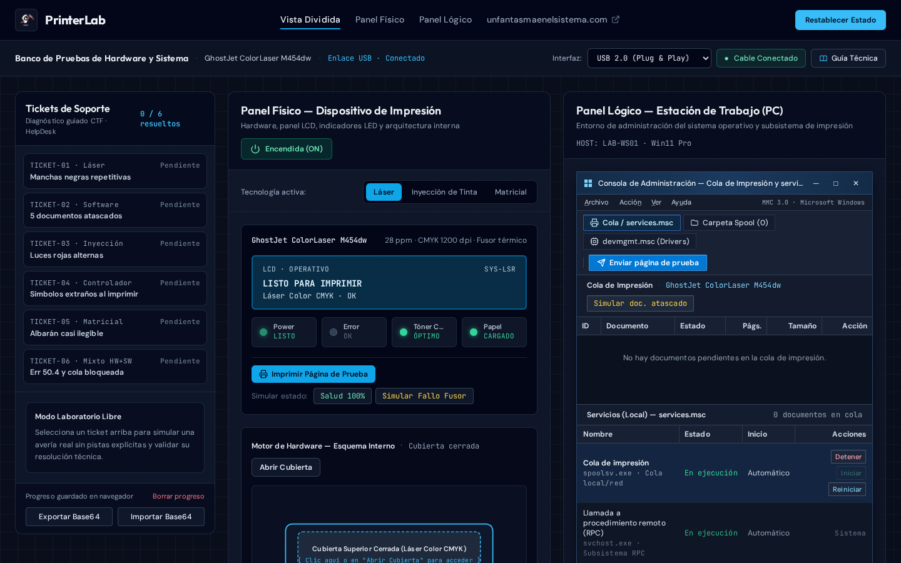
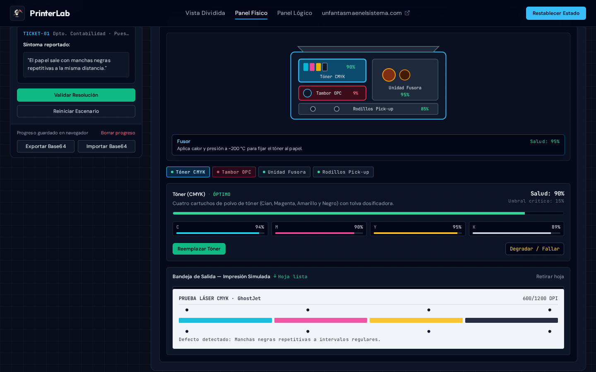
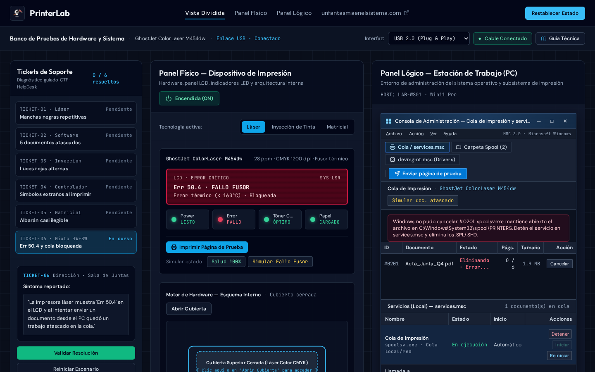

<p align="center">
  <a href="https://www.unfantasmaenelsistema.com/" target="_blank" rel="noopener noreferrer">
    
  </a>
</p>

<h1 align="center">PrinterLab</h1>

<p align="center">
  <strong>Simulador interactivo de diagnóstico y resolución de averías de impresión (Hardware + Windows Spooler + CTF HelpDesk)</strong>
</p>

<p align="center">
  
  
  
  
</p>

<p align="center">
  Proyecto educativo de <a href="https://www.unfantasmaenelsistema.com/" target="_blank" rel="noopener noreferrer">unfantasmaenelsistema.com</a>
</p>

---

## Descripción general

**PrinterLab** es un laboratorio virtual monolítico diseñado para ejecutarse **100 % en el navegador del cliente** (sin backend ni base de datos), orientado a estudiantes de informática, técnicos de soporte N1/N2 y prácticas de HelpDesk.

Combina en un mismo entorno interactivo el **hardware físico de tres tecnologías de impresión** (Láser CMYK, Inyección de Tinta y Matricial de agujas) con una **consola lógica de administración estilo Microsoft Windows (MMC 3.0)** y un **motor de retos CTF / HelpDesk** con validación automática y explicaciones técnicas reales.

---

## Capturas reales de la aplicación

### 1. Vista dividida completa (HelpDesk + Panel Físico + Consola Windows MMC)


### 2. Motor de Hardware abierto, tooltips educativos y simulación de defectos en papel


### 3. Diagnóstico combinado Hardware + Spooler (`Err 50.4` y documento bloqueado en cola)


### 4. Validación CTF ("Flag capturada") y explicación técnica de la causa raíz


---

## Funcionalidades principales

### 1. Panel Físico (Hardware de Impresión)
- **Tres tecnologías simuladas**:
  - **Láser Color CMYK (`GhostJet ColorLaser M454dw`)**: Tóner C/M/Y/K, Tambor OPC, Unidad Fusora (~200 °C) y Rodillos Pick-up.
  - **Inyección de Tinta (`GhostJet InkPro X477`)**: Cartuchos de tinta, Cabezal piezoeléctrico (con rutina de **limpieza de cabezales**) y Caja de mantenimiento / absorbedor residual.
  - **Matricial (`GhostJet DotMatrix LX-350`)**: Cinta entintada (*Ribbon*), Tractor de papel continuo y Cabezal de 9 agujas.
- **Panel frontal realista**: Pantalla LCD con códigos de estado reales (`LISTO`, `AVISO`, `Err 50.4 · FALLO FUSOR`, `Error de servicio 0xEA`) y 4 LEDs animados (`Power`, `Error`, `Consumible`, `Papel`).
- **Cubierta abatible e inspección SVG**: Al pulsar **Abrir Cubierta**, se muestra el diagrama interno interactivo. Al pasar el ratón se despliega un *tooltip* educativo con la función física del componente y su umbral crítico.
- **Impresión simulada con defectos visuales reales**:
  - Tambor OPC dañado → manchas negras repetitivas equidistantes.
  - Fusor térmico averiado → tóner difuminado / sin fijar en el papel.
  - Cabezal de inyección obstruido → bandas horizontales blancas (*banding*).
  - Cinta matricial gastada → texto muy tenue sin error en LCD.
  - Driver PCL genérico incompatible → volcado de secuencias `@PJL / PCL` y caracteres basura.

### 2. Panel Lógico (Estación de Trabajo Windows)
Ventana estilo **Microsoft Management Console (MMC 3.0)** con tres herramientas acopladas al estado físico de la impresora:
- **Cola de Impresión y `services.msc`**:
  - Gestión del servicio **Cola de impresión (`spoolsv.exe`)**: Detener, Iniciar y Reiniciar.
  - Botón **Cancelar** por trabajo: si el trabajo está bloqueado por `spoolsv.exe` o por un fallo físico, simula el clásico estado atascado `"Eliminando - Error..."` de Windows hasta purgar el spool.
- **Explorador de Spool (`C:\Windows\System32\spool\PRINTERS`)**:
  - Visualización de archivos binarios `.SPL` (datos EMF/RAW) y `.SHD` (metadatos de trabajo).
  - Control realista de bloqueo de archivos: Windows impide borrar `.SPL`/`.SHD` mientras `spoolsv.exe` esté en ejecución (*"Archivo en uso"*).
- **Administrador de Dispositivos (`devmgmt.msc`)**:
  - Árbol de dispositivos con alertas de conflicto (triángulo amarillo), detección de controladores **PCL genéricos** incompatibles y acciones de **Desinstalar dispositivo** y **Actualizar controlador**.

### 3. Motor CTF / HelpDesk y Guía Técnica
- **6 escenarios de averías progresivos** que modifican silenciosamente el hardware o el sistema operativo para entrenar el diagnóstico sin pistas iniciales.
- **Persistencia local (`localStorage`)** + **Exportar / Importar progreso en Base64** para compartir o entregar evidencias en clase.
- **Guía Técnica integrada**: modal de referencia rápida accesible desde la barra superior con la metodología por capas (*Físico → Enlace → Driver → Spooler*) y tabla de síntomas.

---

## Escenarios CTF / HelpDesk incluidos

| Ticket | Categoría | Síntoma reportado | Área de diagnóstico |
| :--- | :--- | :--- | :--- |
| `TICKET-01` | Láser | Manchas negras repetitivas a intervalos regulares | Hardware · Tambor OPC + prueba física |
| `TICKET-02` | Software | 5 documentos bloqueados en cola que no se cancelan | `services.msc` + directorio `PRINTERS` (`.SPL`/`.SHD`) |
| `TICKET-03` | Inyección | Luces rojas alternas y mensaje de servicio técnico | Hardware · Caja de mantenimiento al 100 % |
| `TICKET-04` | Controlador | Impresión de símbolos extraños y basura binaria | `devmgmt.msc` · Sustitución de driver PCL genérico |
| `TICKET-05` | Matricial | Albarán casi ilegible sin códigos de error en LCD | Hardware · Cinta entintada gastada + verificación |
| `TICKET-06` | Mixto HW+SW | `Err 50.4` en impresora + trabajo bloqueado en cola | Hardware (Fusor) + recuperación completa del Spooler |

---

## Despliegue en GitHub Pages (Static Ready)

El simulador principal reside íntegramente en `/index.html` con Tailwind CSS vía CDN, Vanilla JS y rutas relativas (`./assets/...`), además del archivo `.nojekyll` en la raíz.

1. Sube el repositorio a GitHub.
2. Ve a **Settings → Pages**.
3. En **Build and deployment**, selecciona **Deploy from a branch**, rama `main` y carpeta `/ (root)`.
4. Guarda los cambios: GitHub Pages servirá `index.html` directamente sin pasos de compilación.

---

## Ejecución local

Puedes abrir directamente `index.html` o levantarlo con cualquier servidor HTTP estático:

```bash
# Opción 1: Servidor estático con Python
python3 -m http.server 3000

# Opción 2: Servidor estático con Node / npx
npx serve . -l 3000

# Opción 3: Mediante el script incluido en el entorno
npm run dev
```

Después abre `http://localhost:3000` en tu navegador.

---

## Estructura del repositorio

```text
.
├── index.html                          # Aplicación monolítica (UI + Motor HW + Consola PC + Motor CTF)
├── assets/aistudio/icono_81a3db5b.png  # Logotipo para despliegue estático en raíz (GitHub Pages)
├── public/assets/aistudio/             # Logotipo para servidores Vite
├── docs/screenshots/                   # Capturas reales de la aplicación
│   ├── 01-vista-general.png
│   ├── 02-hardware-fusor-hover-y-fallo.png
│   ├── 03-consola-windows-spooler.png
│   └── 04-ctf-flag-capturada.png
├── .nojekyll                           # Desactiva Jekyll en GitHub Pages
├── LICENSE                             # Licencia MIT
└── README.md                           # Documentación del proyecto
```

---

## Licencia

Distribuido bajo licencia **MIT**. Consulta el archivo [`LICENSE`](./LICENSE) para más detalles.
